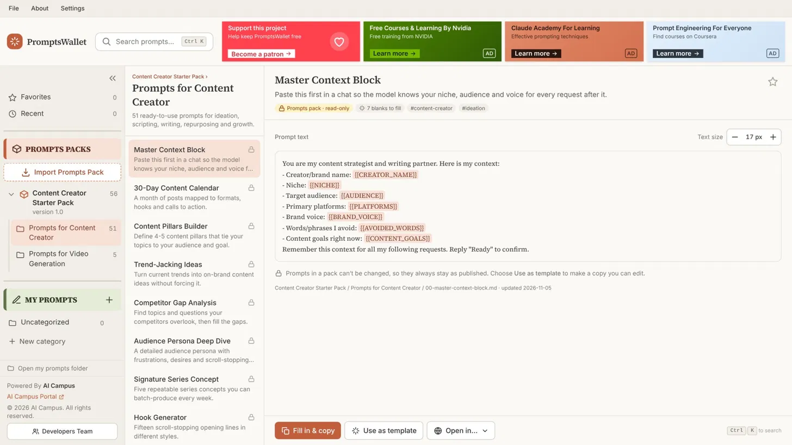
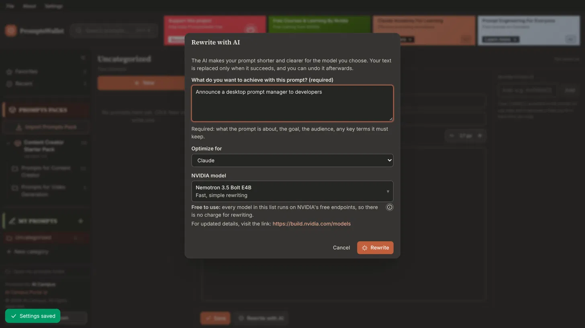
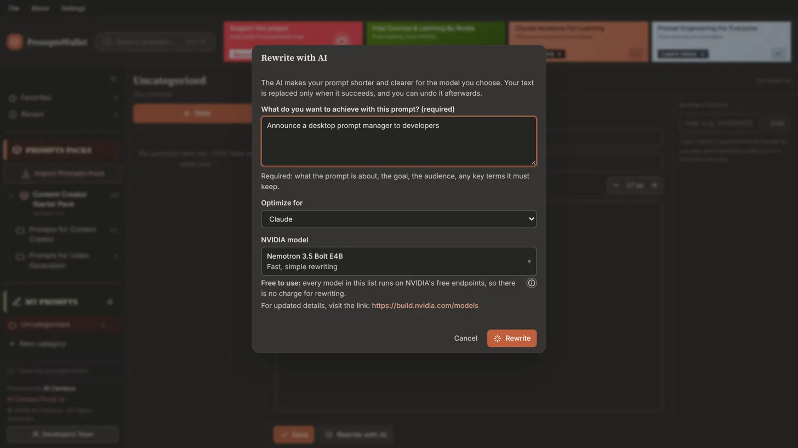

<div align="center">

# PromptsWallet


</div>

**Your prompts, one keystroke away. A fast, private, cross-platform desktop app (Windows, macOS, Linux) to organise, reuse and sharpen the prompts you give to ChatGPT, Claude, Gemini and any other LLM.**



## Why use PromptsWallet?

If you use LLMs every day, the quality of your results depends on your prompts, and most people keep them in scattered notes, chats and browser tabs. PromptsWallet turns that mess into a library you can trust.

- **Better, more accurate answers.** A proven prompt with `{{BLANKS}}` (audience, tone, goal, data...) gives the model the same clear structure every time. You fill in the blanks and copy. You stop re-typing from memory and forgetting the details that make an answer good.
- **Lower token cost.** Short, direct prompts cost less on every call. **Rewrite with AI** tightens a draft for the model you choose (Claude, ChatGPT, Gemini, Copilot, Grok, Llama, Mistral, DeepSeek), removes filler and spells out the task, using NVIDIA's free hosted models. Over hundreds of prompts, the saved tokens add up.
- **Save time.** Search (`Ctrl/⌘ K`), copy and open your LLM in one flow. No hunting through old chats.
- **Keep originals safe, make your own copy.** Prompts from a pack are read-only, so a trusted prompt never gets edited by accident. **Use as template** copies it into **My Prompts** to change as you like.
- **Your data stays yours.** Every prompt is a plain Markdown file in a folder on your disk. No account, no cloud, no lock-in: back it up, sync it or put it in Git. The app works fully offline; it uses the network only when you press **Rewrite with AI**.
- **Works with every LLM.** It is a prompt library, not a chat client, so it fits any tool you already use.
- **Free and open source.**

## Core features

| You want to… | How |
|---|---|
| Browse prompts by category | Left panel: **Prompts Packs** (a tree of pack > category > prompt) and **My Prompts** (yours). Each category is a folder. |
| Copy a prompt | Open it and press **Copy**. If it has `{{BLANKS}}`, **Fill in & copy** shows a form first. Every field starts empty, so you always see what is left to fill. |
| Keep originals safe | Prompts in a pack are **read-only**: no Edit button, and the Rust side refuses to write to them. |
| Make your own version | **Use as template** copies a prompt into My Prompts, where you can edit it freely. |
| Write a prompt from scratch | **New** (or `Ctrl/⌘ N`) in a My Prompts category. **Save** keeps it, **Cancel** discards it. |
| Shorten and improve a prompt | **Rewrite with AI** (next to Save): describe what the prompt is for, pick the LLM to optimise for and an NVIDIA model, and the text is replaced with a tighter version. **Undo rewrite** restores yours. |
| Use it with an LLM website | **Open in…** copies the prompt, then opens Claude, ChatGPT, Gemini or Copilot. |
| Add more prompts | **Import Prompts Pack** imports a `.zip` pack. Importing a newer version of an installed pack offers an update. |
| Create categories | **File** menu: **Create New Prompt**, **Create New Category**. |
| Find things fast | `Ctrl/⌘ K` search. Enter copies, `Ctrl/⌘ Enter` opens. Favorites and Recent in the sidebar. |
| Make it comfortable | **Settings**: Light or Dark theme and an overall font size (10 to 18 px, default 12). The prompt panel also has its own **– / +** text size. |
| Work in the way you like | Collapse the left panel with **«**; long category names wrap. |

Shortcuts: `Ctrl/⌘ K` search · `N` new prompt · `D` use as template · `B` favorite · `Shift C` copy the current prompt.



## Download and install

Ready-made installers are attached to each release.

1. Open the repository's **Releases** page (the **Releases** link on the right of the repository page) and choose the **latest release**.
2. Under **Assets**, download the file for your system:

| System | Download | Notes |
|---|---|---|
| **Windows 10/11** (64-bit) | `PromptsWallet_<version>_x64-setup.exe` (recommended) or `PromptsWallet_<version>_x64_en-US.msi` | Double-click and follow the installer. Windows 11 already has the WebView2 runtime that the app needs; on Windows 10 the installer sets it up if it is missing. |
| **macOS, Apple silicon** (M1 and newer) | `PromptsWallet_<version>_aarch64.dmg` | Open the `.dmg` and drag **PromptsWallet** to **Applications**. |
| **macOS, Intel** | `PromptsWallet_<version>_x64.dmg` | Same as above. |
| **Linux, Debian/Ubuntu** | `PromptsWallet_<version>_amd64.deb` | `sudo apt install ./PromptsWallet_<version>_amd64.deb` |
| **Linux, Fedora/RHEL/openSUSE** | `PromptsWallet-<version>-1.x86_64.rpm` | `sudo dnf install ./PromptsWallet-<version>-1.x86_64.rpm` |
| **Linux, any distribution** | `PromptsWallet_<version>_amd64.AppImage` | `chmod +x PromptsWallet_*.AppImage && ./PromptsWallet_*.AppImage` |

(File names may differ slightly between versions. If you cannot see a file for your system, that release does not include it yet; try the previous one or [build from source](#build-from-source).)

### First start and security warnings

The installers are **not code-signed yet**, so your system may warn you the first time:

- **Windows (SmartScreen):** "Windows protected your PC" > **More info** > **Run anyway**.
- **macOS (Gatekeeper):** if the app will not open, right-click it in **Applications** > **Open** > **Open**. Or go to **System Settings > Privacy & Security** and click **Open Anyway**. If macOS says the app is "damaged", run `xattr -dr com.apple.quarantine /Applications/PromptsWallet.app` once in Terminal.
- **Linux:** none. The `.deb` and `.rpm` install the libraries they need (WebKitGTK).

Download only from this repository's Releases page.

### Where your prompts are stored

In a folder named **PromptVault** inside your **Documents** folder (for example `C:\Users\you\Documents\PromptVault` on Windows). If Documents is not writable, the app uses its own data folder instead. To use another location, set the `PROMPTVAULT_HOME` environment variable before starting the app. The built-in starter pack lives inside the app, never in this folder, so updating the app never touches your files. To uninstall, remove the app as usual; your prompts folder stays until you delete it.

## Build from source

### 1. Install the tools (once)

| Tool | Version | Notes |
|---|---|---|
| [Git](https://git-scm.com) | any recent | |
| [Rust](https://rustup.rs) | stable | installs `cargo`. On Windows pick the default MSVC toolchain. |
| [Node.js](https://nodejs.org) | 22 LTS (20.19 or newer works) | includes `npm` |
| Platform libraries for Tauri | see below | |

- **Windows:** [Microsoft C++ Build Tools](https://visualstudio.microsoft.com/visual-cpp-build-tools/) with the **Desktop development with C++** workload. WebView2 is already part of Windows 11.
- **macOS:** `xcode-select --install`
- **Linux, Debian/Ubuntu:**
  ```bash
  sudo apt update
  sudo apt install libwebkit2gtk-4.1-dev build-essential curl wget file libxdo-dev libssl-dev \
    libayatana-appindicator3-dev librsvg2-dev
  ```
- **Linux, Fedora:** `sudo dnf install webkit2gtk4.1-devel openssl-devel curl wget file libappindicator-gtk3-devel librsvg2-devel libxdo-devel && sudo dnf group install "c-development"`
- **Linux, Arch:** `sudo pacman -S --needed webkit2gtk-4.1 base-devel curl wget file openssl libappindicator-gtk3 librsvg xdotool`

Python is **not** needed.

### 2. Get the code and run it

```bash
git clone https://github.com/<your-username>/<repository>.git
cd <repository>

npm install            # installs the web dependencies (use `npm ci` for an exact, reproducible install)
npm run tauri dev      # compiles the Rust side and opens the desktop app with hot reload
```

The first `tauri dev` compiles all Rust dependencies and takes several minutes. Later starts are fast.

### 3. Check that everything works

```bash
npm run check          # type-checks the UI, runs the core tests and compiles the desktop shell
cargo test --workspace # all Rust tests (core rules + desktop shell)
npm run build          # type-checks and builds the web UI into dist/
```

### 4. Build the installers

```bash
npm run tauri build
```

The installers appear in `src-tauri/target/release/bundle/` (`.msi`/`.exe` on Windows, `.dmg`/`.app` on macOS, `.deb`/`.rpm`/`.AppImage` on Linux). **Each OS builds its own installers**; the GitHub Actions workflow below does all of them for you.

### Browser preview (no Rust needed)

```bash
npm install
npm run dev            # then open http://localhost:1420
```

This runs the same React UI with an in-memory stand-in for the Rust commands (`src/lib/mock.ts`). It loads the real prompts from `library/` but nothing you create is saved, and **Rewrite with AI** is simulated. Handy for UI work. It is not part of production builds.

### Troubleshooting a build

- **`error: failed to run custom build command ... webkit2gtk` (Linux):** the system libraries above are missing.
- **`link.exe not found` (Windows):** install the C++ Build Tools workload and reopen the terminal.
- **Port 1420 already in use:** another dev server is running; stop it and retry.
- **A blank window on Linux inside a VM or over SSH:** try `WEBKIT_DISABLE_DMABUF_RENDERER=1 npm run tauri dev`.

## Rewrite with AI

Optional. It needs your own **free NVIDIA API key**:

1. Create a key at <https://build.nvidia.com/settings/api-keys>.
2. In PromptsWallet open **Settings > AI rewrite**, paste it and press **Save**.
3. In a new prompt, press **Rewrite with AI**, describe what the prompt is for (required), choose **Optimize for** (the LLM you will use) and an **NVIDIA model**, then press **Rewrite**.

All offered models run on NVIDIA's free endpoints (see <https://build.nvidia.com/models> for current details; NVIDIA may limit how many requests you can make). If one fails or is busy, pick another model in the list and try again. Your text is replaced only when the rewrite succeeds, and every `{{BLANK}}` must survive.

| Model | Intended role | Model ID |
|---|---|---|
| Nemotron 3.5 Bolt E4B (default) | Fast, simple rewriting | `nvidia/nemotron-3.5-bolt-e4b` |
| Mistral Large 4 | Complex prompt rewriting | `mistralai/mistral-large-4-1t-a52b` |
| DeepSeek V4.1 Flash | Technical prompt optimization | `deepseek-ai/deepseek-v4.1-flash` |
| Nemotron 3.5 Lightning | Quality and speed | `nvidia/nemotron-3.5-lightning-30b-a3b` |
| GPT-OSS-20B | Lightweight optimization | `openai/gpt-oss-20b` |



**Privacy:** the key is stored on your computer (in the app's local storage) and sent only to NVIDIA. Only the prompt text, the description you type and the chosen LLM are sent, and only when you press Rewrite. The request is made by the Rust side (`src-tauri/src/net.rs`): `POST https://integrate.api.nvidia.com/v1/chat/completions` with a system message (prompt-engineering rules for the chosen LLM) and a user message (your prompt and goal), using the chosen model id as `"model"`. To add a model, add it to `NVIDIA_MODELS` in both `src/lib/settings.ts` and `src-tauri/src/net.rs` (the Rust side accepts only listed ids).

## Prompts packs

A pack is a `.zip` named `promptswallet-pack-<ULID>.zip` (a ULID is a unique 26-character id). The sidebar shows **Prompts Packs > pack > category > prompt**.

```
promptswallet-pack-01M6TCPTTZE1S19QFHPYF0T097.zip
├── config.json     {"prompt-pack-id":"01M6TCPTTZE1S19QFHPYF0T097","title":"winter-2026-release","version":"1.0"}
├── README.md       how to import the pack in PromptsWallet
└── categories/
    └── <Category>/
        └── <prompt>.md
```

- All three items must be there; `config.json` must hold exactly those three fields; category folders may contain only `.md` files. Otherwise you get **"Invalid prompts pack"** with every problem listed, and nothing is written. One wrapper folder around the three items is accepted.
- The import dialog has a **Prompts pack name** field, filled from `title`. The name you choose is the one saved; a name already in use is rejected so you can rename.
- Same id and same version: **"Already imported"** (with the version). Same id, different version: **"Update this prompts pack?"** with both versions; on Confirm the old pack goes to the trash and the new one is imported.
- Imported packs are stored with all their files and metadata in `<your folder>/.promptvault/library/promptswallet-pack-<ULID>/` and are read-only. A built-in pack id cannot be overwritten.
- The **Import Prompts Pack** dialog links to a basic pack on GitHub and an advanced pack from AICampus.

## Where your files live

```
~/Documents/PromptVault/            (change with the PROMPTVAULT_HOME environment variable)
├── My Prompts/
│   ├── Uncategorized/
│   └── Client Work/
│       └── brand-voice-rewriter.md
├── .promptvault/
│   ├── state.json                  favorites and recents
│   ├── library/                    imported prompts packs
│   └── trash/                      deleted prompts, categories and replaced packs (restore by moving back)
└── README.txt
```

### A prompt file

```markdown
---
id: 5K2M…
title: "Brand voice rewriter"
description: "Rewrite text in my brand voice."
tags: [writing, brand]
variables:
  - name: TONE
    label: "Voice"
    placeholder: "friendly, formal, playful"   # shown as a hint under the field
derived_from: cc-42-ruthless-editor      # set when made with "Use as template"
---

Rewrite this in a {{TONE}} voice for {{AUDIENCE}}:

{{DRAFT}}
```

- `{{NAME}}` is a blank to fill in. Letters from any script work (Urdu, Arabic, …).
- The front matter is optional and read leniently; a file with none is still a prompt.
- A file whose front matter is broken still shows up, with a warning, instead of disappearing.

### A category

A category is a folder. Add `_category.yaml` for a description and sort order:

```yaml
description: Prompts for AI video tools.
order: 2
```

## Customise the app (branding, links, banners)

Everything that is specific to a publisher lives in **`src/lib/about.ts`**: app name, About texts, the portal and pack links, developer names/e-mails/profiles, the Patreon link, the NVIDIA API address, and the four banners next to the search bar. Several values are **placeholders (`example.com`, `your-org`, `your-page`)**: replace them before you publish your own build. The two logos in the Import dialog (`src/assets/logo-github.svg`, `src/assets/logo-aicampus.svg`) are generic placeholders too; replace the files with your own logos.

The three ad-style banners show fixed text and links and make **no network calls**. To fetch them from an ad service instead, set `apiUrl` for a banner in `about.ts`; the service returns JSON with `data.title`, `description`, `advertiser`, `target_url`, `data.banner.image_url` and optionally `refresh_interval` (the app asks again every 60 s by default). Only `http(s)` links are ever opened.

## Project layout

```
.
├── crates/pv-core/        All the rules, with no UI and no Tauri (76 tests)
│   └── src/  guard.rs (read-only rule) · vault.rs (everything the app can do)
│            pack.rs (prompts packs) · prompt.rs (front matter) · template.rs ({{blanks}})
│            library.rs (folder scan) · slug.rs (safe names) · state.rs (favorites, recents)
├── src-tauri/             Thin Tauri shell: commands in src/lib.rs, the NVIDIA call in src/net.rs,
│                          permissions in capabilities/
├── src/                   React + Tailwind UI
│   ├── App.tsx            state, navigation, copy flow, shortcuts
│   ├── components/        Sidebar · PromptList · PromptView · Editor · CopyDialog · dialogs · banners …
│   └── lib/               api.ts (Tauri calls) · about.ts (branding, links) · settings.ts
│                          hooks.ts · mock.ts (browser preview) · …
├── library/               Built-in starter pack (Markdown), bundled into the app
├── app-preview/           Screenshots used in this README
└── .github/workflows/     CI: tests on every push/PR, installers on version tags
```

### How the read-only rule is enforced

1. Built-in and imported packs live in a different folder from **My Prompts**.
2. Every write goes through `Roots::ensure_writable`, which resolves the real path (so `..` and symlinks cannot sneak in) and refuses anything under a pack folder or outside **My Prompts**.
3. The UI does not show Edit for pack prompts either, but the rule does not depend on it.

### Add your own built-in prompts

Drop a `.md` file into a category folder under `library/promptswallet-pack-<ULID>/categories/` and run:

```bash
cargo test -p pv-core  # checks every shipped prompt: valid front matter, unique ids, no unused blanks
```

## Tests

```bash
cargo test --workspace # 76 core tests + 16 in the desktop shell: file rules, packs, templates, shipped library, the NVIDIA request
npm run typecheck      # TypeScript
npm run check          # typecheck + core tests + a Rust compile check of the desktop shell
```

## Releases (for maintainers)

Pushing a version tag builds the installers for every OS and attaches them to a **draft** GitHub Release (`.github/workflows/build.yml`: macOS Apple-silicon and Intel, Windows, Linux).

1. Set the new version in `package.json`, `src-tauri/Cargo.toml`, `src-tauri/tauri.conf.json` and `ABOUT.version` in `src/lib/about.ts`.
2. Commit, then tag and push: `git tag v0.2.0 && git push origin v0.2.0`.
3. When the workflow is green, open **Releases**, check the draft and its assets, and **Publish** it.

Every push and pull request also runs the type-check and the Rust tests.

## Good to know

- **Open in…** copies the prompt first, then opens the site. Claude and ChatGPT are asked to pre-fill the chat box with a `?q=` link; that is up to those sites and may change, so check `src/lib/providers.ts` if it stops working. Pasting always works.
- The window never scrolls as a whole; only the panels inside it do (this also fixes a stray scrollbar on Windows with display scaling).

## Roadmap

Not built yet: a global (system-wide) hotkey palette, per-LLM output formats (such as XML-tagged prompts for Claude), zip export of prompt packs, version history, and a "Run" button using your own API keys. The core is separate from the UI, so these can be added without rewriting it.

## Contributing

Issues and pull requests are welcome. Before opening a pull request, run `npm run check` and `cargo test --workspace`.
